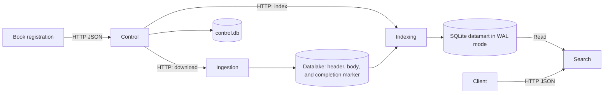

# InverSeek

InverSeek is a search engine for Project Gutenberg books. It downloads texts, publishes an inverted index, and exposes a REST API for searching by terms and metadata. Four independent Java 17 processes use Javalin, JSON, and SQLite.

## Architecture



| Component | Local port | Responsibility |
| --- | ---: | --- |
| [Control](control-module/README.md) | 7000 | Book registration, persistent queue, retries, and coordination of Ingestion and Indexing. |
| [Ingestion](ingestion-service/README.md) | 7001 | Downloads books and publishes complete files to the datalake. |
| [Indexing](indexing-service/README.md) | 7002 | Extracts metadata, generates postings, and publishes the datamart in a transaction. |
| [Search](search-service/README.md) | 7003 | Reads the published index and provides search, book details, and filters. |

Ingestion publishes the completion marker after writing the book files. Indexing validates the content and is the sole writer of the datamart. Search opens a consistent read-only view. Control keeps its state in a separate SQLite database.

## Build and run

The examples use PowerShell on Windows. Install JDK 17 and put Maven on `PATH`. Downloading the corpus requires access to Project Gutenberg.

From the repository root, run the following commands.

```powershell
$env:JAVA_HOME = 'C:\path\to\jdk-17'
$env:PATH = "$env:JAVA_HOME\bin;$env:PATH"
java -version
mvn clean package
```

The Maven reactor builds and tests all four modules. To build one module separately, run `mvn -f <module>/pom.xml package`. Each module produces an executable JAR in `target/`. See its README for standalone launch and path configuration instructions.

Start all services with a separate data directory for this deployment.

```powershell
$dataDir = Join-Path (Get-Location) 'data/demo'
.\scripts\start-all.ps1 -DataDir $dataDir -JavaExe "$env:JAVA_HOME\bin\java.exe"
```

The script waits for health checks and stores endpoints, process information, and logs in the data directory. To start replicas in another deployment, specify `-IngestionReplicas 2 -SearchReplicas 3` and use available ports, for example with `-PortOffset 1000`. See the [deployment configuration](docs/deployment/configuration-matrix.md).

## Register books and search

```powershell
Invoke-RestMethod -Method Post -Uri 'http://localhost:7000/control/books' `
    -ContentType 'application/json' -Body '{"ids":[11,1342,2701]}'
Invoke-RestMethod -Uri 'http://localhost:7000/control/status'
```

Registration is asynchronous. Check the status until all three books reach `INDEXED` and the queue is idle. Then run the example queries below.

```powershell
Invoke-RestMethod -Uri 'http://localhost:7003/search?q=whale&language=en&limit=5'
Invoke-RestMethod -Uri 'http://localhost:7003/search?q=love&author=Austen'
Invoke-RestMethod -Uri 'http://localhost:7003/books/1342'
Invoke-RestMethod -Uri 'http://localhost:7003/search/filters'
```

Search combines terms with AND, ranks results by relevance, and returns `total`, pagination information, and the index version. The year filter accepts known values. The current pipeline leaves `year=null` because it does not extract the original publication year from Gutenberg.

The API contracts are in each module's `openapi.yaml` and are summarized in the [endpoint inventory](docs/api/endpoint-inventory.md). The modules also include `.http` examples and test scripts.

Stop the deployment with the following command.

```powershell
.\scripts\stop-all.ps1 -DataDir $dataDir
```

## Functional validation

`mvn test` runs the service tests. System validation starts real processes with isolated data, checks API contracts, the book workflow, and recovery from failures, then stops the services.

```powershell
.\system-tests\scripts\validate-all.ps1 -JavaExe "$env:JAVA_HOME\bin\java.exe"
```

See the [validation instructions](system-tests/README.md) and [test coverage](docs/validation/README.md). Integration tests are opt-in and run separately from the default Maven build.

## Benchmarks and results

The [recorded campaign](benchmarks/results/2026-11-08T222200-full/README.md) covers 116 JMH combinations, 33 HTTP runs, 36 pipeline runs, and 10 figures. It includes CSV files, logs, host configuration, corpus hashes, and a ZIP archive of raw samples. Results apply to the host and workload described in the campaign.

To reproduce the campaign, stop other InverSeek deployments, build the services and the load client, and install `pandas` and `matplotlib` in your Python environment. Use fresh directories for the run.

```powershell
mvn -f benchmarks/load-client/pom.xml package
$run = Get-Date -Format 'yyyyMMddTHHmmss'
$work = Join-Path (Get-Location) "data/benchmark-campaigns/$run"
$out = Join-Path (Get-Location) "benchmarks/results/$run"
$java = Join-Path $env:JAVA_HOME 'bin/java.exe'
$snapshot = Join-Path $work 'snapshot'
.\benchmarks\prepare-corpus.ps1 -DataDir (Join-Path $work 'corpus') -Snapshot $snapshot -JavaExe $java
.\benchmarks\run-campaign.ps1 -OutDir $out -WorkRoot (Join-Path $work 'work') `
    -Snapshot $snapshot -JavaExe $java -PythonExe (Get-Command python).Source
```

The campaign runs the full JMH suite, followed by Search and pipeline measurements. It can take more than an hour. The [benchmark guide](benchmarks/README.md) explains how to run individual blocks and regenerate figures from saved measurements.

## Deployment limits

Replicas run on one host and share the local datalake and datamart. SQLite uses a single writer. To rebuild the index, wait for Control to finish its active work and resume book registration once the rebuild completes.
