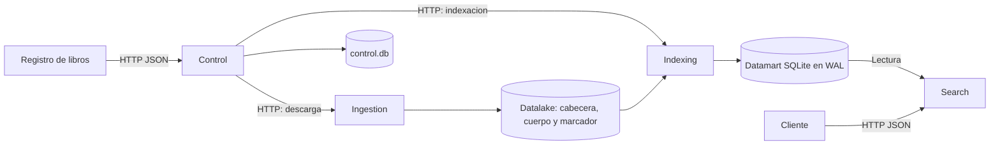

# InverSeek

Buscador de libros de Project Gutenberg. Descarga el texto, publica el índice invertido y permite buscar por términos y metadatos a través de una API REST. Los cuatro servicios se ejecutan como procesos independientes en Java 17, con Javalin, JSON y SQLite.

## Arquitectura



| Componente | Puerto local | Responsabilidad |
| --- | ---: | --- |
| [Control](control-module/README.md) | 7000 | Registro, cola persistente, reintentos y coordinación de Ingestion e Indexing. |
| [Ingestion](ingestion-service/README.md) | 7001 | Descarga libros y publica archivos completos en el datalake. |
| [Indexing](indexing-service/README.md) | 7002 | Extrae metadatos, genera postings y publica el datamart en una transacción. |
| [Search](search-service/README.md) | 7003 | Lee el índice publicado y ofrece búsqueda, detalles y filtros. |

El marcador de Ingestion se publica al final de la escritura. Indexing valida el contenido y es el único escritor del datamart; Search abre una vista consistente de solo lectura. Control mantiene su estado en una base SQLite separada.

## Compilar y arrancar

Los ejemplos usan PowerShell en Windows. Se necesita un JDK 17 y Maven en `PATH`. Project Gutenberg debe ser accesible para descargar el corpus.

Desde la raíz del repositorio:

```powershell
$env:JAVA_HOME = 'C:\ruta\al\jdk-17'
$env:PATH = "$env:JAVA_HOME\bin;$env:PATH"
java -version
mvn clean package
```

El reactor compila y prueba los cuatro módulos. Para compilar uno por separado, usa `mvn -f <modulo>/pom.xml package`. Cada módulo genera su JAR ejecutable en `target/`; consulta su README para lanzarlo por separado y configurar sus rutas.

Para arrancar todos los servicios con datos separados de otras ejecuciones:

```powershell
$dataDir = Join-Path (Get-Location) 'data/demo'
.\scripts\start-all.ps1 -DataDir $dataDir -JavaExe "$env:JAVA_HOME\bin\java.exe"
```

El script espera la respuesta de salud y guarda endpoints, procesos y logs en el directorio de datos. Para arrancar réplicas en otro despliegue, indica `-IngestionReplicas 2 -SearchReplicas 3` y usa puertos disponibles (por ejemplo `-PortOffset 1000`). Consulta la [configuración de despliegue](docs/deployment/configuration-matrix.md).

## Registrar libros y consultar

```powershell
Invoke-RestMethod -Method Post -Uri 'http://localhost:7000/control/books' `
    -ContentType 'application/json' -Body '{"ids":[11,1342,2701]}'
Invoke-RestMethod -Uri 'http://localhost:7000/control/status'
```

El registro es asíncrono. Consulta el estado hasta que los tres libros estén en `INDEXED` y no haya trabajo activo. Después:

```powershell
Invoke-RestMethod -Uri 'http://localhost:7003/search?q=whale&language=en&limit=5'
Invoke-RestMethod -Uri 'http://localhost:7003/search?q=love&author=Austen'
Invoke-RestMethod -Uri 'http://localhost:7003/books/1342'
Invoke-RestMethod -Uri 'http://localhost:7003/search/filters'
```

Search combina términos con AND, ordena por relevancia y devuelve `total`, paginación y versión del índice. El filtro por año admite valores conocidos, pero el pipeline actual no obtiene el año original de publicación de Gutenberg: sus libros llevan `year=null`.

Los contratos están en los `openapi.yaml` de cada módulo y se resumen en el [inventario de endpoints](docs/api/endpoint-inventory.md). Hay ejemplos `.http` y scripts de prueba en los módulos.

Para detener el despliegue:

```powershell
.\scripts\stop-all.ps1 -DataDir $dataDir
```

## Validación funcional

`mvn test` ejecuta las pruebas de los servicios. La validación de sistema arranca procesos reales con datos aislados, verifica contratos, flujo de libros y recuperación ante fallos, y detiene los servicios al acabar:

```powershell
.\system-tests\scripts\validate-all.ps1 -JavaExe "$env:JAVA_HOME\bin\java.exe"
```

Consulta las [instrucciones de validación](system-tests/README.md) y su [cobertura](docs/validation/README.md). Las pruebas de integración se activan de forma explícita y no se ejecutan en una compilación Maven normal.

## Benchmarks y resultados

La [campaña medida](benchmarks/results/2026-11-08T222200-full/README.md) incluye 116 combinaciones JMH, 33 ejecuciones HTTP, 36 del pipeline y 10 gráficas. Conserva CSV, logs, configuración del equipo, huellas del corpus y un ZIP con las muestras de origen. Las cifras corresponden al equipo y a la carga indicados en esa campaña.

Para repetirla, detén primero otros despliegues de InverSeek, compila los servicios y el cliente de carga e instala `pandas` y `matplotlib` en tu entorno Python. Utiliza directorios nuevos:

```powershell
mvn -f benchmarks/load-client/pom.xml package
$run = Get-Date -Format 'yyyyMMddTHHmmss'
$work = Join-Path (Get-Location) "data/benchmark-campaigns/$run"
$out = Join-Path (Get-Location) "benchmarks/results/$run"
$java = Join-Path $env:JAVA_HOME 'bin/java.exe'
$snapshot = Join-Path $work 'snapshot'
.\benchmarks\prepare-corpus.ps1 -DataDir (Join-Path $work 'corpus') -Snapshot $snapshot -JavaExe $java
.\benchmarks\run-campaign.ps1 -OutDir $out -WorkRoot (Join-Path $work 'work') `
    -Snapshot $snapshot -JavaExe $java -PythonExe (Get-Command python).Source
```

La campaña usa JMH completo y después mide Search y el pipeline. Puede durar más de una hora. La [guía de benchmarks](benchmarks/README.md) explica cómo ejecutar los bloques por separado y regenerar las gráficas sin repetir las mediciones.

## Límites del despliegue actual

Las réplicas se ejecutan en una sola máquina con almacenamiento local. Comparten el datalake y el datamart; SQLite tiene un único escritor y las cifras no representan un clúster. Para reconstruir todo el índice, deja terminar el trabajo de Control y evita nuevos registros hasta que finalice la operación.
